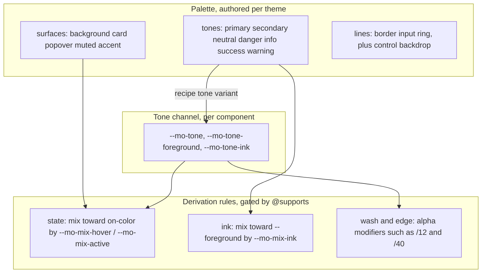

# Variant x Tone and a rebuilt color derivation system

## Problems with the current system

- `--mo-auto-X-{hover,active}` is a fixed matrix: 11 roles x 2 states = 22 custom properties declared on every element (`*, ::before, ::after`). Adding tint, border and text derivations on the same model would push that past 60.
- Tones (danger and the other status colors) and surfaces (accent, muted and so on) use the same state model, although their use cases differ completely.
- The configuration surface is heavy. Per-role states accept a string, a number or a callback, and there is also `colorStates` plus a separate `@supports` block for numeric overrides.
- Tinted backgrounds and borders are already written ad hoc as alpha modifiers (`bg-danger/15`, `ring-danger/20`), outside the token system.

## New model: three layers



Core rules:

- **Brand tones vs built-in tones (consumers generally author `primary`, `secondary`, and `accent`):**
  - **Brand / Theme tones (`primary`, `secondary`)**: Primary is the central brand/accent color; secondary is the secondary brand/support tone. In `DEFAULT_THEME_COLORS`, primary stays `rgb(23, 23, 23)` / `rgb(250, 250, 250)` light, `rgb(229, 229, 229)` / `rgb(23, 23, 23)` dark; secondary is a brand anchor like primary — a dark, high-contrast color in light mode (light in dark mode), just a different hue — so the generic alpha wash (`/12`), edge (`/40`) and ink formulas produce visible results. Today's `rgb(245, 245, 245)` secondary is a surface value and would wash out like the `#f5f5f5` neutral example below, so it is replaced. `<Button variant="solid" tone="secondary">` produces a dark slate brand-support fill (not the old light-gray secondary fill).
  - **Proposed secondary defaults (PROPOSAL — Jerry to confirm):** restrained low-chroma slate.
    - light: `secondary: { base: 'rgb(51, 65, 85)', foreground: 'rgb(248, 250, 252)' }` (slate-700 / slate-50)
    - dark: `secondary: { base: 'rgb(203, 213, 225)', foreground: 'rgb(15, 23, 42)' }` (slate-300 / slate-900)
    - Computed (sRGB approximation of the mixes; WCAG contrast):
      - light on white: solid fg/base 9.9:1; `bg-tone/12` ≈ `rgb(231, 232, 235)` (visible cool-gray wash, 1.23:1 vs white, same strength as neutral /12); `border-tone/40` ≈ `rgb(173, 179, 187)` (2.1:1, crisp edge); ink (25% toward `--foreground` `rgb(10,10,10)`) ≈ `rgb(41, 51, 66)` — 12.7:1 on white, 10.4:1 on the /12 wash.
      - dark on `rgb(10, 10, 10)`: solid fg/base 12.0:1; `bg-tone/12` ≈ `rgb(33, 34, 36)` (1.25:1, visible); `border-tone/40` ≈ `rgb(87, 91, 96)` (2.9:1); ink (25% toward `rgb(250,250,250)`) ≈ `rgb(215, 222, 231)` — 14.6:1 on background, 11.7:1 on the /12 wash.
      - The real formulas mix in oklch; results differ by a few RGB units but contrast conclusions hold.
  - **Built-in tones (`neutral`, `danger`, `info`, `success`, `warning`)**: Moraine supplies complete built-in defaults in `DEFAULT_THEME_COLORS`. `neutral` is Moraine's built-in monochrome/black-and-white tone (used out-of-the-box by neutral controls, default soft badge, outline/ghost buttons, pagination). Status tones (`danger`, `info`, `success`, `warning`) provide built-in feedback colors. Users rarely need to touch built-in tones, but may override them if needed.
  - Together with the surface role `accent`, users generally only need to define **`primary`**, **`secondary`**, and **`accent`** to theme an entire Moraine application.
  - All 7 tones are equal first-class citizens in the tone channel, sharing the exact same generic formulas (`--mo-tone`, `--mo-tone-foreground`, `--mo-tone-ink`) with zero special-cased class lists.
- **Tones are high-contrast anchors; Surfaces are pre-tinted backgrounds.**
  - A *Surface* (like `muted: rgb(245, 245, 245)`) is an opaque, low-contrast background fill.
  - A *Tone* in an alpha-tinting system (Radix / Nuxt UI) is the full-contrast color anchor whose alpha washes (`/12`, `/40`) generate visible surfaces, borders, and readable text. If `neutral.base` were set to `#f5f5f5`, `bg-tone/12` on white would be `#fefefe` (invisible), `border-tone/40` would be `#fbfbfb` (invisible), and `text-tone-ink` would mix into `#bbbbbb` (1.45:1 contrast, failing WCAG AA).
  - Therefore, the built-in `neutral` tone in `DEFAULT_THEME_COLORS` uses high-contrast anchor defaults matching the monochrome primary scale:
    - light: `neutral: { base: 'rgb(23, 23, 23)', foreground: 'rgb(250, 250, 250)' }`
      - `bg-tone/12` on white yields `~#e3e3e3` (a visible soft gray wash).
      - `border-tone/40` on white yields `~#a2a2a2` (a crisp outline border).
      - `hover:bg-tone/10` yields `~#e8e8e8` (a visible ghost hover wash).
      - `text-tone-ink` yields dark text with $> 10:1$ contrast.
    - dark: `neutral: { base: 'rgb(250, 250, 250)', foreground: 'rgb(23, 23, 23)' }`
      - `bg-tone/12` on the dark background (verified in `src/theme/defaults.ts`: `rgb(10, 10, 10)` = `#0a0a0a`) yields `10 + 0.12 × 240 = rgb(38.8, 38.8, 38.8)` — effectively today's dark secondary surface (`rgb(38, 38, 38)`).
  - **Accepted visual changes (Jerry approved):** `neutral` is identical to `primary` in the default theme (both monochrome anchors; they diverge once a theme authors a branded primary). Default `soft + neutral` badges (`/12` ≈ `#e3e3e3` on white) are darker than the old accent-filled badge (`#f5f5f5`).
  - Surfaces are `background`, `card`, `popover`, `muted`, `accent`. All 5 surfaces remain unchanged in `DEFAULT_THEME_COLORS` for static opaque background uses.
- **Identity is per role, states are generic.** Each role only authors `base` and `foreground`. Tones may also author an `ink`.
- **There are only three derivation rules.**
  - state (hover/active): mix toward the role's on-color.
  - ink: readable text on a neutral surface, made by mixing toward `--foreground`.
  - alpha: wash and edge colors come from alpha modifiers (`bg-tone/12`, `border-tone/40`), with no new token names. Transparent tints are intentional (as in Radix / Nuxt UI / Park UI): one token works on any surface. On colored containers they blend with the container color.
- **Mix amounts are CSS-variable knobs, not preset numbers:** `--mo-mix-hover` (default 8%), `--mo-mix-active` (12%) and `--mo-mix-ink` (25%). Defaults come from `var()` fallbacks inside the formulas, so nothing needs to be emitted by default. Any theme selector or subtree can tune them, for example raising ink in `.dark`.
- **Tone channel:** the component writes 3 variables inline through recipe style keys. The tone's hover/active are derived generically on `*` from `--mo-tone`, so per-tone state tokens are no longer needed.

## Token details: [src/theme/tokens.ts](src/theme/tokens.ts)

Canonical tone list and tone type:

```ts
export const TONES = [
  'primary',
  'secondary',
  'neutral',
  'danger',
  'info',
  'success',
  'warning',
] as const
export type Tone = (typeof TONES)[number]
```

Surfaces (`background`, `card`, `popover`, `muted`, `accent`): `DEFAULT`, `foreground`, `hover`, `active`. Utility values keep the explicit-then-derived-then-base chain. The private derived variable is renamed `--mo-X-hover`:

```ts
hover: 'var(--accent-hover, var(--mo-accent-hover, var(--accent)))'
```

Tones (`primary`, `secondary`, `neutral`, `danger`, `info`, `success`, `warning`): `DEFAULT`, `foreground`, `ink`. **`-hover` / `-active` are removed.**

```ts
secondary: {
  DEFAULT: 'var(--secondary)',
  foreground: 'var(--secondary-foreground)',
  ink: 'var(--secondary-ink, var(--mo-secondary-ink, var(--secondary)))',
},
neutral: {
  DEFAULT: 'var(--neutral)',
  foreground: 'var(--neutral-foreground)',
  ink: 'var(--neutral-ink, var(--mo-neutral-ink, var(--neutral)))',
},
danger: {
  DEFAULT: 'var(--danger)',
  foreground: 'var(--danger-foreground, var(--background))',
  ink: 'var(--danger-ink, var(--mo-danger-ink, var(--danger)))',
},
```

Notice `secondary` and `neutral` have built-in `base` and `foreground` defaults in `DEFAULT_THEME_COLORS` (like `primary`), so their `foreground` resolves directly to `var(--secondary-foreground)` and `var(--neutral-foreground)` rather than falling back to `--foreground` or `--background`. Only status colors (`danger`, `info`, `success`, `warning`), which omit `foreground` in defaults, fall back to `--background`. This uses the existing `usesBackgroundForegroundFallback(color)` helper (`src/theme/tokens.ts`, backed by the `BACKGROUND_FOREGROUND_COLORS` set; consumed in `src/theme/unocss.ts`); keep that set limited to the four status tones and do not add `secondary` / `neutral`.

The tone channel color group (cannot be authored in theme config):

```ts
tone: {
  DEFAULT: 'var(--mo-tone)',
  foreground: 'var(--mo-tone-foreground)',
  hover: 'var(--mo-tone-hover, var(--mo-tone))',
  active: 'var(--mo-tone-active, var(--mo-tone-hover, var(--mo-tone)))',
  ink: 'var(--mo-tone-ink)',
}
```

`TONE_VARS` holds the recipe style keys, derived directly from `MORAINE_COLORS` as a single source of truth without duplicated strings:

```ts
export const TONE_VARS: Record<Tone, Partial<Record<`--${string}`, string>>> =
  Object.fromEntries(
    TONES.map((tone) => [
      tone,
      {
        '--mo-tone': MORAINE_COLORS[tone].DEFAULT,
        '--mo-tone-foreground': MORAINE_COLORS[tone].foreground,
        '--mo-tone-ink': MORAINE_COLORS[tone].ink,
      },
    ]),
  ) as Record<Tone, Partial<Record<`--${string}`, string>>>
```

Declarations gated by `@supports (color: color-mix(in oklch, red, white))` on `*, ::before, ::after`. A zero-arg `createGatedColorDeclarations()` replaces `createStateColorDeclarations`:

- Surface states: 5 x 2 = 10, each `color-mix(in oklch, var(--X), <on-color> var(--mo-mix-hover, 8%))` and active `var(--mo-mix-active, 12%)`.
- Tone ink: 7, each `color-mix(in oklch, var(--X), var(--foreground) var(--mo-mix-ink, 25%))`.
- Tone channel states: 2, each `color-mix(in oklch, var(--mo-tone), var(--mo-tone-foreground) var(--mo-mix-hover, 8%))` and active `var(--mo-mix-active, 12%)`.
- 19 declarations in total, down from 22.

Why `--mo-tone-ink` references a role chain, while channel hover is derived on `*`:

- A `color-mix` value written inline can't degrade. On old browsers it becomes invalid at computed-value time and resolves to `unset`.
- So inline values may only contain fallback chains without `color-mix`, and every `color-mix` must stay in the gated `*` rule.
- Ink keeps per-role authoring because readability needs to be tuned per tone (warning and success on white). States don't.

## Compatibility behavior without color-mix

- Surface and tone hover/active fall back to the base color, same as today.
- Ink falls back to the raw tone color, which is readable but lower contrast.
- Alpha wash and edge: background becomes transparent, so soft looks like ghost. Border-color resolves to `currentColor`, which is the ink color. The text still carries the tone.
- Wind3 `/alpha` matcher: remove the dead fallback in `unocss.ts` (the custom `body(entries)` around lines 457–466, after the alpha regex at line 437). Drop the custom `body` function since `color-mix` alone is the intended entry. Also correct the inaccurate statement in `unocss.mdx` around line 180 ("With `wind3: true`, Wind3 keeps the unmodified semantic color as its fallback when `color-mix()` is unavailable").

## Preset configuration (breaking)

[src/theme/unocss.ts](src/theme/unocss.ts) and [src/theme/defaults.ts](src/theme/defaults.ts):

- `DEFAULT_THEME_COLORS`: add built-in `neutral` tone defaults (`base` and `foreground`) for light and dark themes.
- Theme authoring experience: consumers generally only need to define `primary`, `secondary`, and `accent` (and optionally surfaces such as `background` or `card`). Built-in tones (`neutral`, `danger`, `info`, `success`, `warning`) are fully provided by Moraine out-of-the-box.
- Surface entries: `string | { base?, foreground?, hover?, active? }`, where the state values are CSS strings only.
- Tone entries: `string | { base?, foreground?, ink? }`.
- Remove `colorStates`, `MoraineColorStateValue` (numbers and callbacks), `MoraineColorStateResolverContext`, `DEFAULT_COLOR_STATES` and the separate numeric `@supports` block.
- Add `mix?: Partial<Record<'hover' | 'active' | 'ink', number | string>>` to `MorainePresetTheme`, emitted per theme selector as `--mo-mix-*: N%` (number formatted as `${n}%`, string used as-is).
- In `mergeTheme()`, shallow-merge `mix`: `mix: { ...base.mix, ...override?.mix }`.
- In `unocss.ts`, wind3 regex:
  - Add both `neutral` and `tone` to group names: `(background|foreground|primary|neutral|secondary|card|popover|muted|accent|danger|info|success|warning|border|input|control|ring|tone)`.
  - Add `ink` to state suffixes: `(?:-(foreground|hover|active|ink))?`.

[src/theme/tailwind.ts](src/theme/tailwind.ts): `addBase` uses the zero-arg gated declarations. Knobs are set by the user in CSS.

## Components

### Button ([button.recipe.ts](src/element/button/button.recipe.ts), [button.style-types.ts](src/element/button/button.style-types.ts), [button.tsx](src/element/button/button.tsx))

- `variant`: `'solid' | 'soft' | 'outline' | 'ghost' | 'link'`
- `tone`: `Tone` (default `solid + primary`)
- `base.root`: replace `FOCUS_VISIBLE_CLASS` with `focus-visible:(outline-none ring-3 ring-tone/20 dark:ring-tone/40)`
- Variant classes (same formulas for every tone, including neutral — zero compounds):
  - `solid`: `bg-tone text-tone-foreground hover:bg-tone-hover active:bg-tone-active border-transparent`
  - `soft`: `bg-tone/12 text-tone-ink hover:bg-tone/18 active:bg-tone/24 border-transparent`
  - `outline`: `border-tone/40 text-tone-ink bg-transparent hover:bg-tone/8 active:bg-tone/12`
  - `ghost`: `border-transparent text-tone-ink hover:bg-tone/10 active:bg-tone/16`
  - `link`: `text-tone-ink underline-offset-4 hover:underline border-transparent`
- In `button.tsx`: add `'tone'` to `splitProps` so it is consumed by `useRecipe` and does not leak as an invalid HTML attribute on `<Dynamic ... {...rest}>`.
- Migration from old values:
  - `default` becomes solid with tone primary (`variant="solid" tone="primary"`).
  - `secondary` becomes **soft with tone neutral** (`variant="soft" tone="neutral"`). Old secondary was a light-gray fill (`#f5f5f5`); `neutral /12` on white ≈ `#e3e3e3` is the closest look under the new model. It does NOT map to `tone="secondary"`, which is now a dark slate brand anchor.
  - `outline` becomes outline with tone neutral (`variant="outline" tone="neutral"`).
  - `ghost` becomes ghost with tone neutral (`variant="ghost" tone="neutral"`).
  - `link` becomes link with tone primary (`variant="link" tone="primary"`).
  - `danger` becomes solid with tone danger (`variant="solid" tone="danger"`).

### Badge ([badge.recipe.ts](src/element/badge/badge.recipe.ts), [badge.style-types.ts](src/element/badge/badge.style-types.ts), [badge.tsx](src/element/badge/badge.tsx))

- `variant`: `'solid' | 'soft' | 'surface' | 'outline'`
- `tone`: `Tone` (default `soft + neutral`)
- Variant classes (same formulas for every tone, including secondary and neutral — zero compounds):
  - `solid`: `bg-tone text-tone-foreground border-transparent shadow-surface`
  - `soft`: `bg-tone/12 text-tone-ink border-transparent`
  - `surface`: `bg-tone/12 text-tone-ink border-tone/30`
  - `outline`: `bg-transparent text-tone-ink border-tone/40`
- `subtle` is renamed `soft`. Default `soft + neutral` uses the same generic soft formula on the neutral color role — not via special-case classes.
- In `badge.tsx`: add `'tone'` to `splitProps` so `styleProps` includes it and it does not leak into `rest` spread on the DOM.

### Forwarding components

- **ButtonGroup** ([button-group.style-types.ts](src/element/button-group/button-group.style-types.ts), [button-group.recipe.ts](src/element/button-group/button-group.recipe.ts), [button-group-context.ts](src/element/button-group/button-group-context.ts), [button-group.tsx](src/element/button-group/button-group.tsx)):
  - Add `tone?: ButtonStyleVariant['tone']` to `ButtonGroupStyleVariant`.
  - Add `tone: {}` to `buttonGroupRecipe.variants`.
  - Add `readonly tone?: ButtonT.Variant['tone'] | null` to `ButtonGroupContextValue`.
  - Provide `get tone() { return variants.tone }` in `ButtonGroupProvider`.
- **FeedbackAction & FeedbackActionButton** ([feedback.types.ts](src/overlay/base/feedback/feedback.types.ts), [feedback-action.tsx](src/overlay/base/feedback/feedback-action.tsx)):
  - Add `tone?: ButtonT.Variant['tone']` to `FeedbackAction` and `FeedbackActionButton`.
  - Pass `tone={props.action?.tone ?? props.tone}` to `<Button>`.
- **ToggleButton** ([toggle-button.recipe.ts](src/element/toggle-button/toggle-button.recipe.ts), [toggle-button.types.ts](src/element/toggle-button/toggle-button.types.ts), [toggle-button.tsx](src/element/toggle-button/toggle-button.tsx)):
  - `variant` / `activeVariant` move to new values (default `ghost` / `soft`).
  - `tone` / `activeTone` added (default `neutral` / `neutral`).
  - In `toggle-button.tsx`: add `'tone'` and `'activeTone'` to `splitProps`.
  - Pass `tone={pressed() ? variants.activeTone : variants.tone}` to `<Button>`.
- **Pagination** ([pagination.recipe.ts](src/navigation/pagination/pagination.recipe.ts), [pagination.style-types.ts](src/navigation/pagination/pagination.style-types.ts), [pagination.tsx](src/navigation/pagination/pagination.tsx)):
  - `variant` / `activeVariant` / `controlVariant` (defaults `ghost` / `outline` / `ghost`).
  - Add `tone` variant (default `neutral`).
  - Forward `tone={variants.tone}` to both page item `<Button>`s and prev/next control `<Button>`s.
- **Toast item** ([toast-item.tsx](src/overlay/toast/toast-item.tsx)):
  - Cancel button: `variant="soft" tone="neutral"` (today `variant="secondary"` at `toast-item.tsx:608`; soft neutral keeps the light-gray look instead of becoming a dark slate solid).
  - Action button: `variant="solid" tone="primary"` (or forwards `action.tone`).
  - Close button: `variant="ghost" tone="neutral"`.
- **AlertDialog** ([alert-dialog-entry.tsx](src/overlay/alert-dialog/alert-dialog-entry.tsx)):
  - Cancel button: `variant="outline" tone="neutral"`.
  - Action button: `variant="solid" tone={options().danger ? 'danger' : 'primary'}`.

### Consumers & Text Roles

- Menu danger item ([menu.recipe.ts](src/overlay/base/menu/menu.recipe.ts)): `text-danger` becomes `text-danger-ink`. Keep `bg-danger/15`.
- Field error ([field.recipe.ts](src/form/field/field.recipe.ts)): becomes `text-danger-ink`.
- Required indicators ([field.recipe.ts](src/form/field/field.recipe.ts), [checkbox.recipe.ts](src/form/checkbox/checkbox.recipe.ts), [switch.recipe.ts](src/form/switch/switch.recipe.ts), [checkbox-group.recipe.ts](src/form/checkbox-group/checkbox-group.recipe.ts)): migrate `text-danger` to `text-danger-ink`.
- Select-field duplicate tag input ([select-field.recipe.ts](src/form/shared/select/select-field.recipe.ts)): `data-duplicate:text-danger` becomes `data-duplicate:text-danger-ink`.
- input-number control button `text-primary-hover/active`: becomes `hover:text-primary/80 active:text-primary/70`. The `docs-a` shortcut in `docs/unocss.config.ts` is handled the same way.
- Invalid rings in `recipe-common` (`ring-danger/20`) are unchanged.

#### Audit: removed tone state tokens and old `secondary` usages (rg, 2026-10-17)

Tone `-hover` / `-active` tokens (`primary|secondary|danger|info|success|warning`) and `--mo-auto-*` disappear; `secondary` stops being a surface. Every hit outside `plan.md`:

Source (must change):
- `src/element/button/button.recipe.ts:42,45,57` — old `default` / `secondary` / `danger` variant strings using `bg-*-hover` / `bg-*-active` → replaced by the generic tone-channel variants (`hover:bg-tone-hover active:bg-tone-active`).
- `src/form/input-number/input-number.recipe.ts:18` — `active:text-primary-active hover:text-primary-hover` → `hover:text-primary/80 active:text-primary/70`.
- `src/overlay/toast/toast-item.tsx:608` — `variant="secondary"` → `variant="soft" tone="neutral"`.
- `src/theme/unocss.ts:437` — alpha regex lists `secondary` and `-(foreground|hover|active)`; update per the wind3 regex section (add `neutral|tone`, `ink`). `src/theme/unocss.ts:74,238,241` — `colorStates` option → removed (replaced by `mix`).
- `docs/unocss.config.ts:20` — `docs-a` `hover:text-primary-hover` → `hover:text-primary/80`.

Docs demos (`variant="secondary"` → `variant="soft" tone="neutral"`), 21 hits:
- `docs/pages/components/(general)/button-group/separator.tsx:6,8`; `(general)/card/header-action.tsx:10`; `(general)/toggle-button/variants.tsx:10` (`variant="secondary" activeVariant="danger"` → `variant="soft" tone="neutral" activeVariant="solid" activeTone="danger"`).
- `(overlay)/popover/dismiss-control.tsx:14`; `(overlay)/dialog/scrollable-fullscreen.tsx:13,27`; `(form)/form/manual-error.tsx:36`; `(form)/input-group/actions.tsx:53`.
- `form-integration.tsx` submit buttons in `(form)/` select, checkbox-group, radio-group, checkbox, input-number, switch, input, file-upload, textarea, multi-select, combobox, slider.

Docs prose:
- `docs/pages/docs/(styling)/design.mdx:20,33` (`bg-primary-hover`, `--<color>-hover/active` rows) → surfaces only; tones use `bg-tone-hover` / alpha.
- `docs/pages/docs/(styling)/customization.mdx:34` — `bg-danger hover:bg-danger-hover` → `<Button variant="solid" tone="danger">` or `bg-danger hover:bg-danger/90`.
- `docs/pages/docs/(overview)/unocss.mdx:253` and `docs/pages/docs/(overview)/tailwind.mdx:75` — `--primary-hover` state variable guidance → rewrite for surfaces + `--mo-mix-*` knobs. `unocss.mdx` `colorStates` mentions → `mix`.
- `docs/DESIGN.md:68` — `--primary-hover` / `--primary-active` → drop; mention derived tone states.
- `docs/shared/color-tokens.ts:14,16` (doc comments) and `docs/shared/color-tokens.test.ts:34,35,68` (`primary-hover` / `primary-active` tokens) → tone rows expose `ink`; state rows only for surfaces.

Tests / fixtures:
- `src/theme/tailwind.test.ts:138-145,219-251,1038-1043` and `src/theme/unocss.test.ts:229-265,532-546,565-580,620-652,705-721,782-805,832-848` — `--mo-auto-*`, tone `-hover/-active`, `colorStates` assertions → rewrite (gated declarations, `mix` knobs, `bg-secondary` stays valid as a tone utility).
- `test/consumer-fixtures/unocss.test.ts:148-153` — `--primary-hover` fixture → use a surface state (e.g. `--accent-hover`) or `--mo-mix-hover`.
- `test/types-default/index.tsx:625` — `variant="secondary"` → `variant="soft" tone="neutral"`; `test/types-default/preset-theme.ts` `colorStates` → `mix`.
- `src/element/button/button.test.tsx:186-187,1158,1183`; `src/element/button-group/button-group.test.tsx:199,221,316`; `src/element/toggle-button/toggle-button.test.tsx:51,58,237`; `src/overlay/toast/toast.test.tsx:123`; `src/form/input-number/input-number.test.tsx:1529-1530` — `bg-secondary` / `*-hover` class assertions → assert `bg-tone` / `bg-tone/12` plus `--mo-tone` style.

Counts: 123 matching lines across 41 files (including `colorStates`): 4 `src` files (button.recipe, input-number.recipe, toast-item, unocss.ts), 19 demo files (21 hits), 8 docs prose/tooling/config files, 10 test/fixture files. No `--mo-auto-secondary` reference exists outside tests.

## Docs and tests

- Rewrite the color sections of [unocss.mdx](<docs/pages/docs/(overview)/unocss.mdx>) (Hover and active colors, the configuration table), [design.mdx](<docs/pages/docs/(styling)/design.mdx>) and [customization.mdx](<docs/pages/docs/(styling)/customization.mdx>). Update [docs/shared/color-tokens.ts](docs/shared/color-tokens.ts).
- Migrate `variant="danger"`, `variant="secondary"`, and `variant="subtle"` across docs, demos and `test/types-default`.
- Tests checking `className` for `bg-danger` (alert-dialog and others) check `--mo-tone` in `style` and the presence of `bg-tone`.
- Rewrite the `--mo-auto` assertions in unocss/tailwind tests. Add tests for mix knob emission and the guarantee that no inline value contains `color-mix`.
- Document that alpha tints are intentional (like Radix / Nuxt UI / Park UI) so one token works on any surface. On colored containers (e.g. inside a warning Alert or a colored banner), tinted variants (soft / surface / ghost / outline hover) blend with the container color, so prefer `solid` or `outline` there.
- Run `pnpm run qa` and `pnpm run test`.
